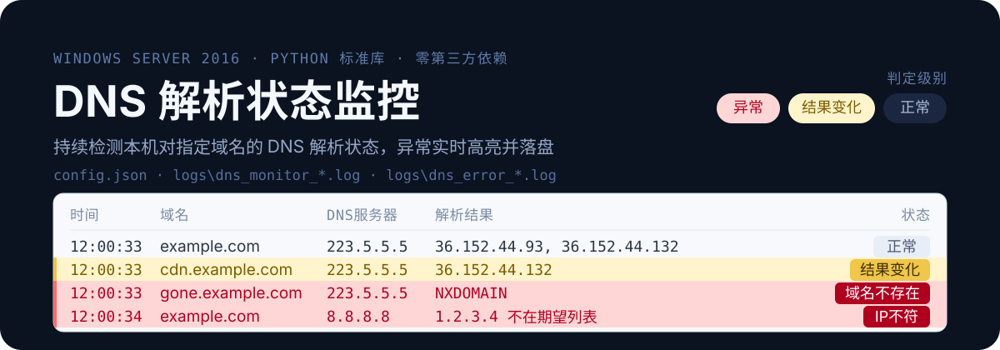

<p align="center">
  <a href="./README.en.md">English</a> · <b>简体中文</b>
</p>

<p align="center">
  
</p>

# DNS 解析状态监控程序

在 Windows Server 2016（及 Windows 10/11）上运行的图形界面监控工具，
持续检测本机对指定域名的 DNS 解析状态，异常实时高亮并落盘。

纯 Python 标准库实现，**不依赖任何第三方包**（打包脚本除外）。

> ⭐ **觉得有用？欢迎点个 [Star](https://github.com/reteng/dns_monitor/stargazers) 支持一下** —— 这能让更多人发现这个项目。

## 功能

- **多域名、多 DNS 服务器**：每个域名可指定一个或多个 DNS 服务器，交叉组合监测
- **异常判定**：解析失败 / 超时 / NXDOMAIN / 返回错误码 / 空结果（NODATA）
- **期望 IP 校验**：结果不在配置的期望 IP 集合内即告警，可发现 DNS 劫持与污染
- **变化提示**：解析结果与上次不同时黄色高亮（提示级，不计入异常统计）
- **实时面板**：记录流式追加，异常红底、变化黄底；高频更新不卡顿
- **双日志文件**：全量日志 + 异常日志，按日切分

## 快速开始

### 源码运行

```console
python main.py
```

需要 Python 3.8 或更高版本（含 tkinter，Windows 官方安装包默认自带）。
启动后切到「配置」页添加域名与 DNS 服务器，保存后回到「实时监控」页点「启动监测」。

静默启动（不显示控制台窗口）：

```console
pythonw main.py
```

### 打包为单文件 EXE

```console
python -m pip install pefile altgraph pywin32-ctypes
python build_exe.py
```

产物为 `dist\DNSMonitor.exe`，可直接复制到目标机运行，目标机无需安装 Python。

若目标机杀软误报，改用 `python build_exe.py --onedir` 生成目录形式，
或为程序目录添加杀软排除项。

## 配置说明

程序首次运行会在**自身所在目录**生成 `config.json` 与 `logs\`。
日志路径始终基于程序位置解析，与启动时的工作目录无关 ——
这样即使由任务计划程序启动（工作目录常为 `C:\Windows\System32`）也能正确写日志。

```json
{
  "interval_seconds": 30,          // 监测间隔（秒），全局统一
  "timeout_seconds": 2.0,          // 单次查询超时（秒）
  "retries": 2,                    // 超时后的重试次数
  "query_type": "A",               // 查询类型：A 或 AAAA
  "max_workers": 8,                // 并发线程数（会自动提升，见下）
  "log_dir": "logs",               // 日志目录，相对路径基于程序目录
  "log_all": true,                 // false 则仅记录异常
  "dns_servers": ["223.5.5.5", "8.8.8.8"],
  "domains": [
    {
      "name": "example.com",
      "enabled": true,
      "expected_ips": ["1.1.1.1"],  // 留空表示不校验
      "alert_on_change": true       // 结果变化时提示
    }
  ],
  "ui": { "max_rows": 5000, "refresh_ms": 150 }
}
```

DNS 服务器支持 `IP#端口` 写法（如 `8.8.8.8#5353`）以使用非标准端口。
配置页的「导入系统DNS」按钮可从注册表读取本机已配置的 DNS 服务器。

## 日志格式

每条记录包含时间戳、域名、所用 DNS 服务器与解析结果：

```text
2026-10-13 12:00:33 example.com 通过 223.5.5.5 解析为 36.152.44.93, 36.152.44.132
2026-10-13 12:00:33 gone.example.com 通过 223.5.5.5 解析失败: NXDOMAIN (域名不存在)
2026-10-13 12:00:33 example.com 通过 223.5.5.5 解析超时 (共等待 6000ms, 单次超时 2000ms, 重试 2 次)
2026-10-13 12:00:33 example.com 通过 223.5.5.5 返回空结果 (NOERROR 但无 A 记录)
2026-10-13 12:00:33 example.com 通过 223.5.5.5 解析为 1.2.3.4 (解析为 1.2.3.4，不在期望列表内 (5.6.7.8))
```

- `logs\dns_monitor_YYYY-MM-DD.log` — 全量记录
- `logs\dns_error_YYYY-MM-DD.log` — 异常与变化提示

## 运行机制说明

**为什么超时不立即判异常？**
本机实测 UDP DNS 存在间歇性丢包：同一服务器、同一域名的连续查询会随机
出现超时。因此单次超时只触发重试，**重试全部耗尽才记为超时异常**，
避免把网络抖动误报为故障。默认重试 2 次，可在配置中调整。

**为什么并发数会自动提升？**
实测 10 个查询任务下，并发数 4 时耗时 2084ms（超时任务排队阻塞），
并发数 8 时仅 42ms。程序会自动把并发数提升到不低于「域名数 × 服务器数」，
防止重试任务串行排队拖长监测周期。

**结果顺序变化为什么不算变化？**
多 IP 域名（如 CDN）常采用轮询返回，同一组 IP 的顺序会变化。
程序比较的是地址集合而非顺序，避免产生大量误报。

**高频更新为什么不卡顿？**
工作线程只把结果投入队列，界面每 150ms 批量取出并一次性插入表格，
超出上限时整批删除最旧行。实测高频灌入下界面单帧最大耗时约 6.5ms，
远低于约 100ms 的卡顿阈值。

## 无人值守部署

### 开机自启

方式一（推荐，需要桌面会话显示界面）：
打开「任务计划程序」→ 创建任务 → 触发器选「登录时」→
操作填 `程序或脚本` 指向 `DNSMonitor.exe`，`起始于` 填其所在目录。

方式二（源码方式静默启动）：
```console
pythonw.exe D:\DNSMonitor\main.py
```

### 网络自检

```powershell
Test-NetConnection -ComputerName 223.5.5.5 -Port 53
```

`TcpTestSucceeded : True` 表示到该 DNS 服务器的 53 端口可达。
Windows Server 2016 默认允许出站，通常无需修改防火墙。

### 日志清理

日志按日切分，建议定期归档 30 天前的文件。可在程序目录放置如下批处理，
配合任务计划程序定期执行：

```bat
forfiles /p "D:\DNSMonitor\logs" /m dns_*.log /d -30 /c "cmd /c del @path"
```

## 自检

```console
python selftest.py            全部检查（含联网用例）
python selftest.py --offline  仅离线检查（不依赖网络）
```

自检覆盖 DNS 报文编解码、异常场景判定、配置读写与校验、
日志写入、规则判定、引擎调度，以及 Python 3.8 语法兼容性闸门。

## 文件说明

| 文件 | 职责 |
|---|---|
| `main.py` | 入口：DPI 感知、异常兜底、启动界面 |
| `dns_query.py` | DNS 报文构造与解析、网络查询 |
| `monitor_engine.py` | 周期调度、并发查询、异常判定规则 |
| `log_writer.py` | 独立写线程、双日志文件、按日切分 |
| `config.py` | 配置读写校验、路径解析、系统 DNS 探测 |
| `gui.py` | tkinter 界面：实时监控页与配置页 |
| `selftest.py` | 无界面自检 |
| `build_exe.py` | PyInstaller 打包脚本 |

## 许可证

[MIT](./LICENSE)

---

⭐ 如果这个项目帮你节省了时间，点个 Star 就是最好的支持 —— 也能帮更多人发现它。**[Star 本项目](https://github.com/reteng/dns_monitor/stargazers)**
