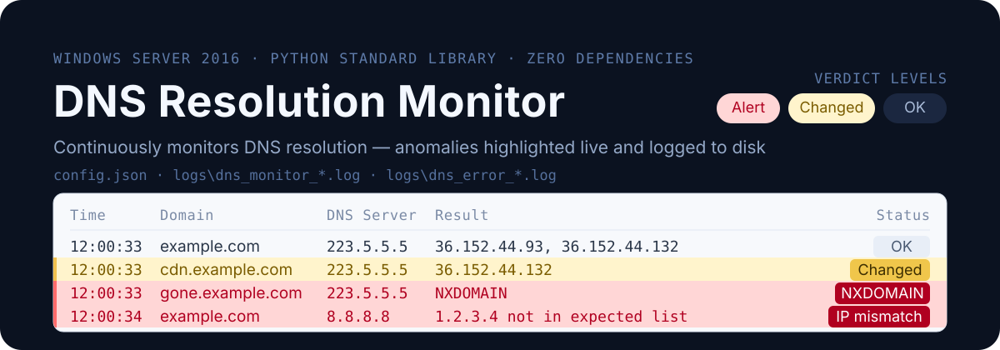

<p align="center">
  <b>English</b> · <a href="./README.zh-CN.md">简体中文</a>
</p>

<p align="center">
  
</p>

# DNS Resolution Monitor

A GUI monitoring tool for Windows Server 2016 (and Windows 10/11) that
continuously checks how this machine resolves configured domains — anomalies
are highlighted in real time and written to log files.

Built entirely on the Python standard library — **no third-party packages**
(except for the optional packaging script). The UI is in Chinese.

> ⭐ **Found this useful? Please consider [starring the repo](https://github.com/reteng/dns_monitor/stargazers)** — it helps more people discover it.

## Features

- **Multiple domains × multiple DNS servers**: each domain can be checked against one or more DNS servers, in all combinations
- **Anomaly detection**: resolution failure / timeout / NXDOMAIN / error rcode / empty answer (NODATA)
- **Expected-IP verification**: alerts when the result falls outside the configured expected IP set — catches DNS hijacking and poisoning
- **Change hints**: yellow highlight when the result differs from the previous check (informational, not counted as an anomaly)
- **Live panel**: records stream in, anomalies on red, changes on yellow; stays smooth under high update rates
- **Dual log files**: full log + error log, rotated daily

## Quick Start

### Run from source

```console
python main.py
```

Requires Python 3.8 or later (with tkinter, included in the official Windows
installer). After launch, switch to the "Configuration" tab to add domains and
DNS servers, save, then return to the "Live Monitoring" tab and click "Start".

Silent launch (no console window):

```console
pythonw main.py
```

### Build a single-file EXE

```console
python -m pip install pefile altgraph pywin32-ctypes
python build_exe.py
```

The output is `dist\DNSMonitor.exe` — copy it to the target machine and run it;
Python is not required there.

If antivirus flags the executable, use `python build_exe.py --onedir` to
produce a directory layout instead, or add an exclusion for the program folder.

## Configuration

On first run the program creates `config.json` and `logs\` **next to itself**.
Log paths are always resolved relative to the program location, never the
working directory — so logging still works when started by Task Scheduler
(whose working directory is usually `C:\Windows\System32`).

```json
{
  "interval_seconds": 30,          // check interval in seconds (global)
  "timeout_seconds": 2.0,          // per-query timeout in seconds
  "retries": 2,                    // retries after a timeout
  "query_type": "A",               // record type: A or AAAA
  "max_workers": 8,                // concurrency (auto-raised, see below)
  "log_dir": "logs",               // log directory; relative paths resolve against the program directory
  "log_all": true,                 // false = only log anomalies
  "dns_servers": ["223.5.5.5", "8.8.8.8"],
  "domains": [
    {
      "name": "example.com",
      "enabled": true,
      "expected_ips": ["1.1.1.1"],  // empty = no verification
      "alert_on_change": true       // hint when the result changes
    }
  ],
  "ui": { "max_rows": 5000, "refresh_ms": 150 }
}
```

DNS servers accept an `IP#port` form (e.g. `8.8.8.8#5353`) for non-standard
ports. The "Import system DNS" button on the configuration tab reads the
machine's configured DNS servers from the registry.

## Log format

Each record contains a timestamp, the domain, the DNS server used, and the
result. Log lines are written in Chinese:

```text
2026-10-13 12:00:33 example.com 通过 223.5.5.5 解析为 36.152.44.93, 36.152.44.132
2026-10-13 12:00:33 gone.example.com 通过 223.5.5.5 解析失败: NXDOMAIN (域名不存在)
2026-10-13 12:00:33 example.com 通过 223.5.5.5 解析超时 (共等待 6000ms, 单次超时 2000ms, 重试 2 次)
2026-10-13 12:00:33 example.com 通过 223.5.5.5 返回空结果 (NOERROR 但无 A 记录)
2026-10-13 12:00:33 example.com 通过 223.5.5.5 解析为 1.2.3.4 (解析为 1.2.3.4，不在期望列表内 (5.6.7.8))
```

- `logs\dns_monitor_YYYY-MM-DD.log` — all records
- `logs\dns_error_YYYY-MM-DD.log` — anomalies and change hints

## Design notes

**Why doesn't a single timeout count as an anomaly?**
Measured on real machines, UDP DNS shows intermittent packet loss: consecutive
queries for the same domain against the same server time out at random. A
single timeout therefore only triggers a retry — **only when all retries are
exhausted is it recorded as a timeout anomaly**, avoiding false alarms from
network jitter. Default: 2 retries, configurable.

**Why is concurrency raised automatically?**
With 10 query tasks, concurrency 4 took 2084 ms (timed-out tasks blocked the
queue), while concurrency 8 took only 42 ms. The program raises concurrency to
at least "domains × servers" so retry tasks don't serialize and stretch the
monitoring cycle.

**Why doesn't a reordering of results count as a change?**
Multi-IP domains (e.g. CDNs) often rotate the order of the same address set.
The program compares the address *set*, not the order, avoiding a flood of
false "changed" hints.

**Why doesn't the UI stutter under high update rates?**
Worker threads only push results into a queue; the UI drains it every 150 ms
and inserts a batch at once, deleting the oldest rows in one batch when over
the limit. Measured worst-case frame time under heavy load is ~6.5 ms — far
below the ~100 ms stutter threshold.

## Unattended deployment

### Start at boot

Option 1 (recommended; requires a desktop session to show the UI):
Open Task Scheduler → Create Task → trigger "At log on" → action "Start a
program" pointing to `DNSMonitor.exe`, with "Start in" set to its folder.

Option 2 (silent launch from source):

```console
pythonw.exe D:\DNSMonitor\main.py
```

### Network self-check

```powershell
Test-NetConnection -ComputerName 223.5.5.5 -Port 53
```

`TcpTestSucceeded : True` means port 53 on that DNS server is reachable.
Windows Server 2016 allows outbound traffic by default; firewall changes are
usually unnecessary.

### Log cleanup

Logs rotate daily. Archiving files older than 30 days is recommended. Place
the following batch file in the program folder and run it periodically via
Task Scheduler:

```bat
forfiles /p "D:\DNSMonitor\logs" /m dns_*.log /d -30 /c "cmd /c del @path"
```

## Self-test

```console
python selftest.py            all checks (includes networked cases)
python selftest.py --offline  offline checks only
```

The self-test covers DNS message encoding/decoding, anomaly classification,
configuration read/write and validation, log writing, rule evaluation, engine
scheduling, and a Python 3.8 syntax-compatibility gate.

## Files

| File | Responsibility |
|---|---|
| `main.py` | Entry point: DPI awareness, exception fallback, launches the UI |
| `dns_query.py` | DNS message construction/parsing, network queries |
| `monitor_engine.py` | Periodic scheduling, concurrent queries, verdict rules |
| `log_writer.py` | Dedicated writer thread, dual log files, daily rotation |
| `config.py` | Config read/write/validation, path resolution, system DNS detection |
| `gui.py` | tkinter UI: live monitoring and configuration tabs |
| `selftest.py` | Headless self-test |
| `build_exe.py` | PyInstaller packaging script |

## License

[MIT](./LICENSE)

---

⭐ If this project saved you time, a star is the easiest way to say thanks — and it helps others find it too. **[Star this repo](https://github.com/reteng/dns_monitor/stargazers)**
